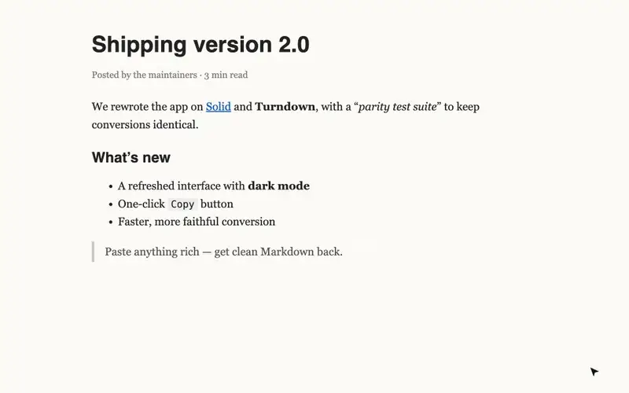

clipboard2markdown
==================

> Easily convert richly formatted text or HTML to
> [Markdown](http://daringfireball.net/projects/markdown/syntax).
> Use the clipboard and paste to Markdown with a single keypress.
>
> The conversion is carried out by
> [Turndown](https://github.com/mixmark-io/turndown) (formerly
> to-markdown), a Markdown converter running in the browser.

Demo
----

### Interactive

<http://euangoddard.github.io/clipboard2markdown/>

### Video



Usage
-----

Open the app, copy some rich text and press `Ctrl+V` (or `⌘+V` on Mac)
anywhere on the page.

On a phone or tablet, tap and hold the paste area at the top of the page,
then choose **Paste**. The area stays above the converted Markdown, so you
can paste again from there. On a tablet with a keyboard, the shortcut
works too.

The converted Markdown is selected, ready to copy with `Ctrl+C`
(or `⌘+C`), or use the **Copy** button.

One can paste multiple times. A paste replaces the selected text, so
pasting straight after a conversion overwrites it; place the cursor in
the output first to insert at that point instead.

Typographic punctuation (“curly quotes”, en and em dashes, the
ellipsis) and no-break spaces are kept as pasted. Switch on **Pandoc
ASCII punctuation** to write the punctuation the way [Pandoc's smart
extension](http://pandoc.org/README.html#smart-punctuation) expects
instead (`"`, `'`, `--`, `---`, `...`), and no-break spaces as ordinary
spaces, which LaTeX accepts. The browser remembers the choice.

Development
-----------

The app is built with [Solid](https://www.solidjs.com/) 2 and
[Vite](https://vite.dev/), and tested with [Vitest](https://vitest.dev/).

```sh
npm install
npm run dev        # start a development server
npm test           # run the test suite
npm run typecheck  # type-check with TypeScript
npm run build      # production build in dist/
```

### Layout

-   `src/converter/` holds the HTML to Markdown conversion: Turndown
    configured with the original Pandoc, GFM and Markdown rules, plus the
    Pandoc clean-up of line breaks and, optionally, punctuation. The
    switch's "Pandoc ASCII punctuation" is `'ascii'` punctuation in the
    code; off is `'typographic'`.
-   `src/App.tsx` is the page: the paste shortcut, the hidden paste target,
    the paste area shown on touch devices, the punctuation switch, and the
    output.
-   `src/punctuationPreference.ts` remembers the punctuation choice in
    `localStorage`.
-   `legacy/` is the original implementation, kept unmodified as a test
    oracle.

### Tests

The suite checks that the rewrite reproduces the original behaviour.
The original always wrote ASCII punctuation, so the parity tests run with
it switched on:

-   `test/converter.test.ts` specifies every conversion rule. Each
    expectation is asserted against both the original converter and the
    new one.
-   `test/parity.test.ts` compares the two converters on a corpus and on
    thousands of seeded random documents. The few intentional differences
    are listed there; all of them fix whitespace bugs in the original.
-   `test/appParity.test.tsx` runs the original page and the new app
    through the same user journeys (shortcut, paste, caret placement,
    repeated pastes) and compares their state after every step.
-   `test/app.test.tsx`, `test/insertText.test.ts`,
    `test/pasteShortcut.test.ts`, `test/cleanUp.test.ts` and
    `test/punctuationPreference.test.ts` cover the individual pieces.

About
-----

[clipboard2markdown](https://github.com/euangoddard/clipboard2markdown)
was created by [Euan Goddard](https://github.com/euangoddard).
The original version used
[html2markdown](https://github.com/kates/html2markdown) by
[Kates Gasis](https://github.com/kates) and
[Himanshu Gilani](https://github.com/hgilani).
[Vegard Øye](https://github.com/epsil) ported it to
[to-markdown](https://github.com/domchristie/to-markdown) by
[Dom Christie](https://github.com/domchristie), which has since become
[Turndown](https://github.com/mixmark-io/turndown). Version 2 is a
rewrite in [Solid](https://www.solidjs.com/) on Turndown.

### License

[![License][license-image]][license-url]

Released under the MIT License. See the [LICENSE](LICENSE) file
for details.

[license-image]: https://img.shields.io/npm/l/markdownlint.svg
[license-url]: http://opensource.org/licenses/MIT
